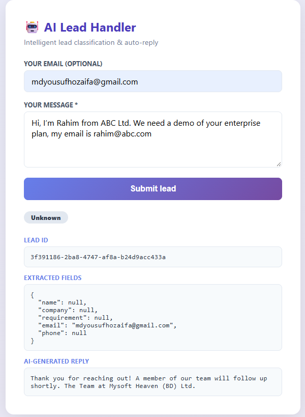

# 🤖 AI Lead Handler

An AI agent workflow that turns an incoming message into a classified, structured and answered lead:
**receive → classify intent → extract fields → generate reply → store → notify (n8n / email)**.

Built as **Assessment 01: AI Agent Workflow Automation** with FastAPI, Groq (Llama 3.1) and n8n.

## 🔗 Live demo

| | |
|---|---|
| **Web app** | https://ai-agent-workflow-automation-with-n8n.onrender.com |
| **Interactive API docs** | https://ai-agent-workflow-automation-with-n8n.onrender.com/docs |
| **Health check** | https://ai-agent-workflow-automation-with-n8n.onrender.com/health |

> ⏳ **Heads-up:** the demo runs on a free Render instance that sleeps when idle.
> The first request after a pause can take up to about a minute to wake it. Later requests are fast.



### Try it
Paste one of these into the web form:

- **Sales:** `Hi, I'm Rahim from ABC Ltd. We need a demo of your enterprise plan. My email is rahim@abc.com`
- **Support:** `My login has been broken since yesterday and I can't access my dashboard.`
- **Spam:** `Buy cheap watches now!!! Click this link!!!`

## ✨ Features

- **Intent classification:** Sales / Support / Spam, using JSON-mode output that is validated and normalised
- **Field extraction:** name, company, requirement, email and phone (`null` when not present, never invented)
- **AI-generated reply:** a personalised response per lead type, with no made-up pricing or promises
- **Graceful failure:** a fallback reply and a `needs_review` status when the LLM fails or returns bad output
- **Persistence:** leads are stored in SQLite
- **Automation hooks:** each lead is forwarded to an n8n webhook for routing, with optional SMTP email replies
- **Security basics:** admin-token-protected lead listing, per-IP rate limiting, prompt-injection-resistant prompts, an XSS-safe UI, and no secrets in the repo

## 🧱 Architecture

```
Web form / REST client / n8n
            │
            ▼
   FastAPI  (/leads, /webhook/lead)
            │
            ├──► Groq API (Llama 3.1): classify + extract, then reply
            ├──► SQLite: store the lead
            ├──► n8n webhook: route by intent (Sales / Support / Spam)
            └──► SMTP (optional): email the AI reply to the sender
```

## 🔌 API

| Method | Endpoint | Description | Auth |
|---|---|---|---|
| `POST` | `/leads` | Submit a lead and get intent, extracted fields and AI reply | none (rate limited) |
| `POST` | `/webhook/lead` | Same pipeline, intended for n8n or other automations | none (rate limited) |
| `GET` | `/leads` | List stored leads | `X-Admin-Token` |
| `GET` | `/leads/{id}` | Get one lead | `X-Admin-Token` |
| `GET` | `/health` | Service status | none |
| `GET` | `/docs` | Swagger UI | none |

**Submit a lead**
```bash
curl -X POST https://ai-agent-workflow-automation-with-n8n.onrender.com/leads \
  -H "Content-Type: application/json" \
  -d '{"message": "Hi, I need a demo of your enterprise plan", "sender_email": "you@company.com"}'
```

**Example response**
```json
{
  "lead_id": "6f1c2a8e-...",
  "intent": "Sales",
  "extracted": {
    "name": null,
    "company": null,
    "requirement": "Demo of the enterprise plan",
    "email": "you@company.com",
    "phone": null
  },
  "ai_reply": "Thank you for your interest ... The Team at Mysoft Heaven (BD) Ltd.",
  "status": "processed",
  "timestamp": "2026-11-02T06:54:30Z"
}
```

**List stored leads (admin only)**
```bash
curl -H "X-Admin-Token: YOUR_ADMIN_TOKEN" \
  https://ai-agent-workflow-automation-with-n8n.onrender.com/leads
```

## ⚙️ Configuration

Copy `.env.example` to `.env` for local use. On a host, set the same names as environment variables.

| Variable | Required | Description |
|---|---|---|
| `GROQ_API_KEY` | yes | Groq API key |
| `ADMIN_TOKEN` | recommended | Enables `GET /leads`; without it those endpoints are disabled |
| `GROQ_MODEL` | no | Default `llama-3.1-8b-instant` |
| `N8N_WEBHOOK_URL` | no | Forward each processed lead to n8n |
| `SMTP_HOST`, `SMTP_PORT`, `SMTP_SENDER`, `SMTP_PASS` | no | Send the AI reply by email |
| `RATE_LIMIT_PER_MIN` | no | Requests per IP per minute (default 10) |
| `DB_PATH` | no | SQLite file path (default `/tmp/leads.db`) |

## 🚀 Run locally

**With Docker (API + n8n):**
```bash
cp .env.example .env          # add GROQ_API_KEY and ADMIN_TOKEN
docker compose up --build
# API:  http://localhost:8000      n8n:  http://localhost:5678
```
Then in n8n, import `n8n/lead_workflow.json` and activate it. The workflow is a starter that routes by intent; replace its placeholder nodes with your own Slack, Sheets or CRM actions.

**Without Docker:**
```bash
pip install -r requirements.txt
uvicorn main:app --reload --port 8000
```

## ☁️ Deployment

Deployed as a Docker web service on **Render** (free tier), built from this repo's `Dockerfile`:

1. Create a Render **Web Service** from this GitHub repo (language: Docker, instance type: Free)
2. Add `GROQ_API_KEY` and `ADMIN_TOKEN` as environment variables
3. Set the health check path to `/health`

The Dockerfile reads Render's `PORT` variable automatically, and Render redeploys on every push to `main`.

## 🧪 Tests

```bash
pip install pytest
python -m pytest -q tests
```
The tests mock the LLM, so they run without an API key. They cover classification, the fallback on invalid model output, input validation, admin-token protection and rate limiting.

## ⚠️ Limitations

- **Cold starts:** the free instance sleeps when idle.
- **Ephemeral storage:** SQLite lives on the instance's temporary disk, so leads reset on restart or redeploy. Use a managed database (for example Postgres) for production.
- **Single instance:** the rate limiter is in-memory and not shared across instances.
- **Model output is probabilistic:** low-confidence or unparseable results are marked `needs_review` rather than trusted.

## 🗂️ Project structure

```
├── main.py                 # FastAPI app: pipeline, API, web form
├── Dockerfile
├── docker-compose.yml      # API + n8n for local use
├── requirements.txt
├── .env.example
├── n8n/lead_workflow.json  # starter n8n routing workflow
└── tests/test_app.py
```

## 👤 Author

**Md. Yousuf Hozaifa**: AI/ML engineer and research assistant at AMIR Lab
[GitHub](https://github.com/Yousuf-Hozaifa)
